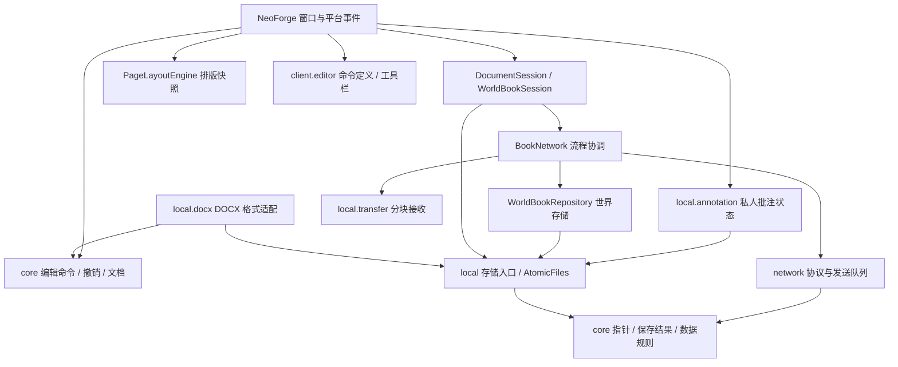

# Writable Book Wiki 系统性重构与架构验收

日期：2026-10-29。当前版本：0.1.4（含 0.1.2 / 0.1.3 架构调整及讲台适配），Minecraft 1.21.1 / NeoForge 21.1.250 / Java 21。

这次调整内部组织和可靠性，保留已经确认的 Word 式编辑方式、MC 书页外观、固定纸宽、实体书权限、个人批注与现有数据。玩家仍只安装一个 JAR。本文补充现有需求与阶段记录，不把尚未完成的副屏窗口、复杂表格或服务器插件算作已完成。

## 1. 实际审查结果与处理

| 实际问题 | 已实施的调整 | 验收方式 |
| --- | --- | --- |
| `BookNetwork` 原有 1,848 行，混合消息格式、接收、发送队列和业务提交 | 消息与校验移到 `network/BookPayloads`、`BookProtocol`；发送队列移到 `PacedBookDelivery`，协调器保留世界书流程 | 旧 JAR 的 18 组协议样本逐字节核对，包含全部 14 类消息 |
| 打开书和保存书各有一份分块接收实现 | 两者共同使用 `local/transfer/DocumentTransferBuffer`；只随有效数据增长内存 | 顺序、长度、重复包、越界、超时和数组隔离回归 |
| 离线、服务器停止没有统一结束静态传输状态 | 接入玩家离线、客户端断线、服务器停止事件；清理缓存、临时图片和发送流 | 自动测试隔离玩家、删除部分文件、释放文件句柄、重复清理 |
| 客户端按键注册类还负责实体书保存会话 | 独立 `ClientBookSessions` 和 `WorldBookSession`；保存、锁定共用请求等待流程 | 不匹配的响应不改指针，匹配确认才推进，断线后的响应不生效 |
| 本地正文、缓存、批注、外观、布局和 DOCX 各自实现临时写入 | 共用 `local/storage/AtomicFiles`；格式校验仍由各存储入口负责 | 写入/校验/移动失败保护原文件，清理临时文件 |
| 原生窗口原有 5,468 行，排版与事件处理交织 | 抽出 `PageLayoutEngine`；窗口只持有排版快照并负责交互/绘制 | 原有 423 项客户端检查继续执行，覆盖框选、任务、混合框、图片和表格 |
| 样式切片、替换、拼接与撤销协调混在编辑器内 | 无状态文字操作集中到 `TextRunEdits`；编辑器仍统一维护文档与撤销 | 原有编辑回归、旧版 EWD 字节与 Hash 检查 |
| DOCX 格式实现和本地存储文件平铺混放 | OOXML 实现集中到 `local/docx`；保留 `DocxIO` 调用入口 | 原有导入导出、独立样例和失败保护测试 |
| 配置限速低于 24 KiB/s 时，队列额度上限小于一个完整包，可能永远不发包 | 额度最多积累一秒或一个分块；保留原有最低有效速率 1 KiB/s | 1 KiB/s 下积累约 24 秒后确实发出完整分块 |
| 工具栏、正文快捷键、表格快捷键重复分发，表格 Ctrl+Shift+X 被剪切抢先消费 | `client.editor/EditorCommand` 统一命令身份，窗口 `performCommand` 统一执行；表格共享格式入口 | 按钮与快捷键结果相等，表格删除线不改剪贴板且可撤销 |
| 批注草稿、排序、锚点历史与磁盘提交混在窗口，失败后仍清空编辑状态 | `local.annotation/AnnotationWorkspace` 独立持有；写成功才更新已接受列表；失败保留草稿 | 单元故障注入和客户端真实文件写入失败/恢复 |
| 锁定确认框只挡按键，不挡字符和右键 | 在输入分发最前面处理确认框，消费字符、右键、滚动和拖动 | 客户端确认框隔离、Esc 只关子框 |
| 根构建没有架构与交付约束 | 加入 `verifyArchitecture`、`verifyReleaseJar`、`verifyAll`、`verifyClientSmoke` 和 CI 配置 | 正向检查、禁止依赖反向注入检查、产物内容检查 |

没有通过搬动全部文件来制造层次，也没有增加空的 Gradle 子模块。图片资源库的“按 Hash 去重、不能覆盖已有资源”与正文的“完整替换”语义不同，继续保留各自的提交规则。

## 2. 模块职责与依赖方向

箭头表示“调用或依赖”：

| 模块或功能包 | 负责什么 | 不负责什么 |
| --- | --- | --- |
| `core` | 文档结构、内容 Hash、编辑规则、选择区、分页、撤销及副本分叉策略 | MC 类型、磁盘路径、窗口和发包 |
| `plugin-api` | 预留未来插件契约的位置，目前只有模块标记 | 目前没有可运行的服务器插件，也没有承诺稳定第三方接口 |
| `local` | 本地存储、Hash 缓存、图片导入、个人批注与偏好 | MC 世界权限、物品更新 |
| `local.annotation` | 个人批注列表、草稿、排序、锚点历史及版本保存 | 正文修改、MC 焦点与渲染、发包 |
| `local.storage` | 完整临时文件的提交与失败清理 | 文档格式、书籍版本和权限 |
| `local.transfer` | 与 MC 无关的有序正文接收 | 网络连接、玩家对象和重试界面 |
| `local.docx` | OOXML 包/XML、图片关系与 Word 格式转换 | 服务器授权、游戏窗口 |
| `neoforge.network` | 协议数据、字段验证、编码及受控分发 | 编辑器状态、业务保存会话 |
| `neoforge` 中的平台协调器 | 物品注册、世界仓库、权限复查、事件接入和最终结果反馈 | 重写核心文档规则 |
| `neoforge.client.editor` | 命令定义、快捷键映射、工具栏布局/绘制/命中 | 持有文档、执行正文修改、文件与网络 |
| `PageLayoutEngine` | 文字/图片/表格/引用框排版，返回共用几何结果 | 编辑命令、网络、保存或窗口事件 |

Gradle 依赖保持：`core` 不依赖其他模块；`plugin-api → core`；`local → core / plugin-api`；`neoforge → core / local / plugin-api`。这些方向构成单向依赖；自动检查拒绝反向项目依赖与源码跨层引用。

`PageLayoutEngine` 使用 Minecraft 的真实字形测量，因此属于平台界面层，不伪装成纯 Java 核心。核心中的 `TextFlowLayout` 继续提供与具体字体无关的排版计算。

## 3. 功能入口

| 要改的功能 | 从哪里开始 | 对应验证 |
| --- | --- | --- |
| 正文编辑、格式、分页、撤销 | `core/.../document/WikiDocumentEditor.java`；文字操作看 `TextRunEdits.java` | `core:test` |
| 字宽、换行、图片环绕、框内表格 | `PageLayoutEngine.java` + `core/.../TextFlowLayout.java` | 核心排版测试 + 客户端回归 |
| 鼠标与焦点路由 | `NativeWikiScreen.java` | 客户端回归；子框隔离、失败后切焦点 |
| 工具栏与快捷键 | `client/editor/EditorCommand.java`、`EditorRibbon.java`；窗口 `performCommand` | 按钮/快捷键结果一致、正文/表格共享命令 |
| 个人批注状态与保存 | `local/annotation/AnnotationWorkspace.java`；窗口只处理焦点与卡片绘制 | `AnnotationWorkspaceTest` + 客户端失败/重试、独立撤销 |
| 实体书复制、锁定和权限 | `BookRevisionPolicy.java`、`BookNetwork.commitSave` / 锁定处理 | 核心规则 + 协议/会话检查；多人实机 |
| 协议字段/包大小 | `network/BookPayloads.java`、`BookProtocol.java` | 冻结协议样本；必要时设计新的协议版本 |
| 下载限速和流生命周期 | `network/PacedBookDelivery.java`、服务器配置 | 客户端环境中的发送队列检查 |
| 本地文件、缓存与偏好 | `Local*Store`、`FileDocumentCache`、`storage/AtomicFiles` | `local:test` |
| DOCX 互通 | `DocxIO` 门面与 `local/docx` | DOCX 独立样例、往返、错误处理 |
| 产物、依赖、检查入口 | 根 `build.gradle`、`gradle/verification.gradle`、`.github/workflows/verify.yml` | `verifyAll` |

讲台新增入口（0.1.4）：`LecternBookSupport` 校验放入；小型 Mixin 只扩展原版对 Wiki 书及逻辑页数的识别；原版 `LecternMenu` 拥有共享页码、取书、距离检查和容器有效性。客户端 `ClientLecternBooks` 在书槽同步后接管界面，`LecternDocumentSession` 只能阅读；退出关闭原版菜单，迟到响应不能重开已退出的阅读窗口。`BookNetwork.loadOrCreateBook` / `deliverBook` 统一手持书与讲台的文档加载、正文校验、分发限制及图片传输。没有新增 Gradle 业务模块。详见 [讲台共享阅读验收](2026-10-29-讲台共享阅读-0.1.4.md)。

## 4. 一次正文保存的完整流程

1. 窗口结束标题和批注输入，固定当前文档快照；批注先写本机，不混入共享正文。
2. 所有正文保存入口经过 `DocumentSession.saveConfirmed`。本地预览写本机；实体书交给 `WorldBookSession`。
3. 实体书会话一次等待一个保存或锁定操作；用请求 ID 关联响应。排队发出数据不表示已经保存成功。
4. `BookNetwork` 编码正文，通过原有头包和 24 KiB 分块发送。服务器检查手持物品及原始指针。
5. `DocumentTransferBuffer` 验证分块次序与精确长度；完整后才交给 Codec 解码。非法包不延长存活时间。
6. 提交时服务器再次验证当前物品、权限、原指针和图片资源；`BookRevisionPolicy` 统一决定不变、只改锁定或内容分叉。
7. 新正文先由 `LocalDocumentStore → AtomicFiles` 写完整文件，再登记世界索引、更新当前实体书指针，最后发送确认。已有副本不被集体改写。
8. 客户端只接受对应会话/手的有效响应，更新该会话指针与已保存 Hash，再反馈成功。失败保留正在编辑的内容；退出自动保存也经过同一路径。

锁定请求继续是独立操作，不重写正文、不改变内容 Hash。图片仍使用分块临时文件与增量 SHA-256 校验，不在正文包或物品数据里塞入图片字节。

`AtomicFiles` 在文件系统支持时使用同目录原子替换，不支持时退回完整文件替换。它保护的是单个文件提交，不是跨世界索引、物品和磁盘的数据库事务，也不承诺断电时所有写入已经刷入硬盘。

## 5. 状态所有权与退出

| 状态 | 所有者 | 生存期/结束方式 |
| --- | --- | --- |
| 当前文档、10 步撤销/重做 | `WikiDocumentEditor` | 一个打开的文档 |
| 选择区、光标、菜单、拖动预览 | `NativeWikiScreen` | 一个窗口；布局和个人批注沿原流程存盘 |
| 批注列表、输入草稿、私人撤销与锚点历史 | `AnnotationWorkspace` | 一个文档窗口；写成功才接受新列表，正常切焦点/退出失败保留草稿；不写正文 |
| 工具栏当前选项卡 | `EditorRibbon` | 一个窗口；最大工具栏高度固定，切页签不推动纸张 |
| 排版结果 | 窗口持有的 `PageLayoutEngine.Snapshot` | 文档、页码、宽度、图片代次或 GUI 比例变化后重算；折叠/拖动沿现有入口失效缓存 |
| 实体书指针、等待确认的操作 | `WorldBookSession` | 服务器确认才推进；断线终止等待并禁用旧会话操作 |
| 请求 ID 到会话的关联 | `ClientBookSessions` | 确认、失败、90 秒超时或断线移除 |
| 客户端当前打开正文和图片接收 | `BookNetwork` 客户端状态 | 完成、45 秒无有效分块、替换或退出 |
| 每位玩家的上传和发送队列 | `BookNetwork` 服务器状态 | 完成、超时、替换、玩家离线或服务器停止 |
| 图片输入流、分发额度 | `PacedBookDelivery` | 队列耗尽/关闭/发包异常时释放 |
| 未完成图片文件 | `ChunkedAssetReceiver` | 校验完成后交付调用者；放弃或校验失败则删除 |

平台回调将业务工作安排到对应游戏主线程。90 秒超时线程只负责完成 Future 和移除并发请求表；窗口的保存反馈重新调度到客户端主线程。清理操作可重复调用，离线一个玩家不清理其他玩家的上传。

## 6. 兼容性范围

- 名称仍为 Writable Book Wiki，MODID 仍为 `writablebookwiki`。
- EWD 编码器、内容 Hash 算法、书籍指针格式及所有存储路径保持原样。
- 网络协议仍为 `1`；14 种包的 ID、字段次序、保存结果枚举次序与限制不变。
- 0.1.1 的固定 EWD 样本包含标题、Unicode、全部富文本种类、全部图片模式、表格、框与分页；0.1.2 重新编码后字节和 Hash 均相同。
- 保存结果枚举移到核心层；`DocxIO` 和编辑器已有公共入口保留。内部 Java 类移动不等于承诺开发中接口的二进制兼容；未来外部插件必须另立接口版本。
- 保留当前 Mod 已有的文档版本读取能力，不增加其他 MODID 或旧开发目录的自动迁移。

## 7. 本轮阶段与剩余边界

本轮按“基线备份与审查 → 有证据的拆分和故障修复 → 自动检查 → 本地交付”执行。0.1.2 检查结果见 [验证记录](2026-10-29-重构验证记录.md)，0.1.3 见 [输入与批注重构](2026-10-29-输入与批注重构-0.1.3.md)，日常修改和恢复方式见 [维护与交付手册](维护与交付手册.md)。

0.1.3 继续分离批注状态与工具栏；窗口协调器从 5,043 行降至 4,823 行，增长门槛降为 4,900 行。输入与卡片绘制等职责仍较多，后续按实际问题继续整理；核心编辑器 1,400 行、网络协调器 1,080 行，其余生产 Java 文件默认 800 行。门槛是防止继续堆积的保护，不代表这些类已经达到最终结构。后续拆分应围绕完整功能、补上对应操作测试，不能只为压行数拆出反向依赖窗口的空壳。

本轮没有改变产品交互，也没有把独立副屏窗口、合并单元格、复杂输入法和多人网络测试范围扩成新功能。现有 DOCX 功能和独立测试样例继续保留。
